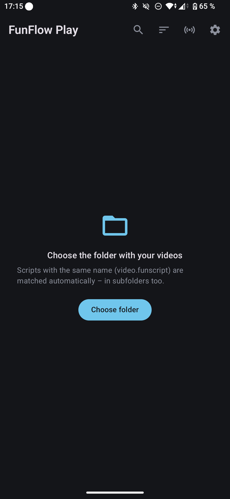
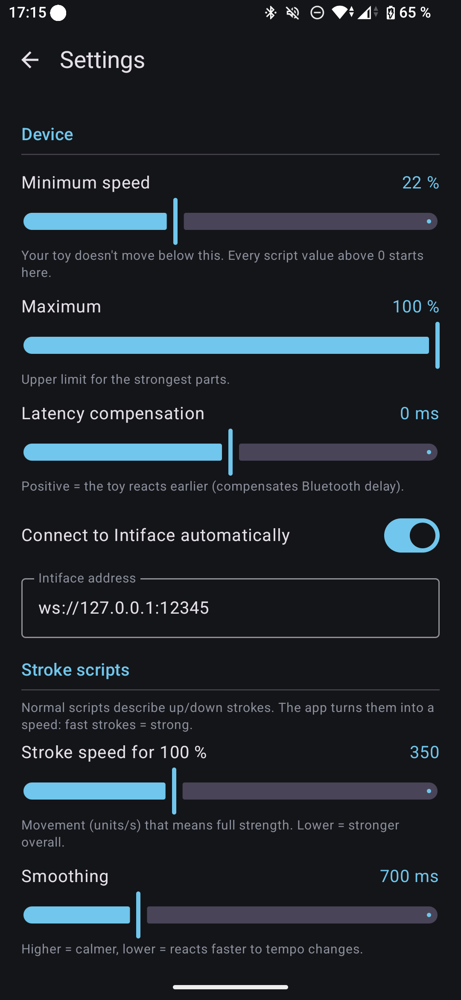

# FunFlow Play

**A clean, fast Android player for videos with funscripts.** Pick your video folder,
tap a video, and your toy follows the script. No thousand settings, just the few
that matter.

- **Your library at a glance:** thumbnails, 4K/HDR badges, script indicator, and it
  remembers where you stopped.
- **Correct 4K and HDR playback** with hardware decoding, so it's smooth and saves battery.
- **Works with any funscript:** normal stroke scripts are turned into a smooth speed.
  Intensity scripts (for example from [FunFlow](https://github.com/SennahDev/funflow))
  are played directly.
- **Made for vibrators and speed-controlled toys:** set the minimum speed your toy
  needs, and every value above 0 starts there.
- **Quick skipping:** double-tap to skip, jump to the next action, and see a heatmap
  on the seek bar.

Works with every toy supported by [Intiface Central](https://intiface.com/central).

<p>
  
  
</p>

---

## Install

You need **Android 10 or newer**.

1. On your phone, open **[Releases](https://github.com/SennahDev/funflow-play/releases)**
   and download `FunFlowPlay-….apk`.
2. Open the downloaded file. Android asks whether your browser may install apps:
   allow it once (*Settings → Install unknown apps*).
3. Tap **Install**.

Updates install the same way, over the old version. Your settings stay.

---

## First start

**1. Your videos**
Tap **Choose folder** and select the folder with your videos. Scripts with the same
name are matched automatically, in subfolders too:

```
My Video.mp4
My Video.funscript        <- found automatically
```

**2. Your toy**
1. Install **Intiface Central** from the Play Store, open it and tap the big
   **Start Server** button. Leave it running in the background.
2. In FunFlow Play tap the **device icon** (top right), then **Scan for devices**,
   and turn your toy on.

**3. Minimum speed (important for vibrators)**
Many toys don't move at all below a certain level. In the device panel, slide the
**Test** slider up slowly and note where your toy starts to move. Enter that value
in **Settings → Minimum speed**. The default is 22 %.

With that, 0 stays off and 1 % already moves. Everything above is scaled up to 100 %,
so small differences in the script stay noticeable.

---

## Watching

| Gesture / button | What it does |
|------------------|--------------|
| Tap | Show / hide controls |
| Double-tap left / right | Skip back / forward (10 s, adjustable) |
| Double-tap middle | Play / Pause |
| ⏮ / ⏭ | Previous / next section with action (skips quiet parts) |
| Seek bar | Drag to scrub; the colors show the script's intensity |
| Device chip (top) | Live strength; tap to turn the toy off/on without pausing |
| ⋮ menu | Script type for this video, video format info |

**Script type:** FunFlow Play detects whether a script describes strokes or
intensity. If a video feels wrong, change it in the ⋮ menu. The choice is saved
per video.

---

## Settings

| Setting | Meaning |
|---------|---------|
| Minimum speed | Below this your toy doesn't move. Every value above 0 starts here. |
| Maximum | Upper limit for the strongest parts. |
| Latency compensation | Positive values make the toy react earlier (Bluetooth delay). |
| Stroke speed for 100 % | For stroke scripts: how fast the movement must be for full strength. Lower = stronger overall. |
| Smoothing | For stroke scripts: higher = calmer, lower = reacts faster. |
| Skip distance | How far a double-tap skips. |
| Intiface address | Normally `ws://127.0.0.1:12345` (Intiface on the same phone). To use Intiface on your PC, enter your PC's address, e.g. `ws://192.168.1.20:12345`. |

---

## FAQ

**The colors of some 4K videos look pink or red.**
These videos are usually in **Dolby Vision profile 5**, which only plays correctly
on phones with a Dolby Vision decoder. FunFlow Play shows the format in the ⋮ menu.
Support for these videos on other phones is planned.

**My toy only has 3 speeds in Intiface.**
The speed resolution comes from Intiface, not from the app. For example, Intiface
drives the Svakom Alex Neo 2 with 3 steps, although the toy can do more.

**Does the app need internet?**
No. It only connects to Intiface Central on your phone or in your home network.
Nothing is uploaded, and there are no ads or tracking.

**Where are my videos stored?**
They stay where they are. The app only reads the folder you chose.

**Something doesn't work.**
Please open an [issue](https://github.com/SennahDev/funflow-play/issues) and describe
what happened.

---

## For developers

Kotlin + Jetpack Compose, Media3 (ExoPlayer) for video, OkHttp for the Buttplug v4 protocol.

```bash
./gradlew testDebugUnitTest   # unit tests
./gradlew assembleRelease     # APK in app/build/outputs/apk/release/
```

Requires JDK 17+ and the Android SDK. Release builds are signed with the key in
`keystore.properties` (not in the repository). Without it, the debug key is used.

Structure: `script/` (funscript parsing, stroke → speed), `device/` (Intiface client,
output mapping), `data/` (library scan, thumbnails, settings), `player/`, `ui/`.

---

## License

MIT, see [LICENSE](LICENSE). Third-party libraries: [THIRD_PARTY_NOTICES.md](THIRD_PARTY_NOTICES.md).

FunFlow Play is not affiliated with Intiface/Nonpolynomial, Svakom or any toy maker.
